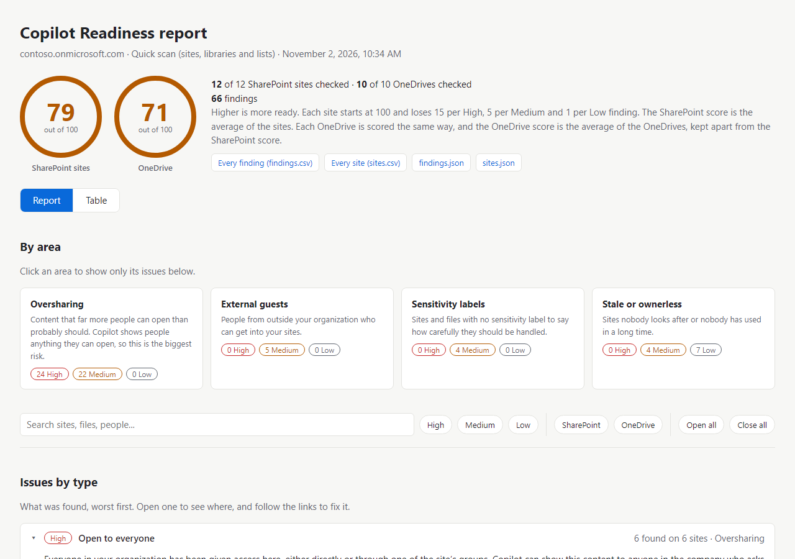
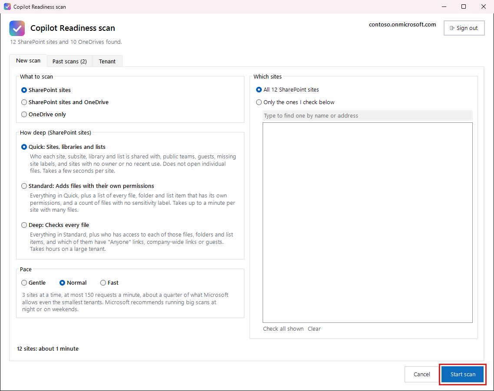

# Copilot Readiness

**See what Microsoft 365 Copilot could show people before you turn it on.**

Copilot shows people anything they already have access to. If a salary spreadsheet is shared with the whole company, anyone can get it just by asking. Copilot Readiness scans your SharePoint sites and OneDrives, finds what's shared too widely, and tells you what to fix first.

There's nothing to build. You download it, double-click it, and it shows you each step on screen.

## What it finds

| Area | What it looks for |
|---|---|
| **Oversharing** | Content open to everyone, "Anyone" links, company-wide links, public teams and groups |
| **External guests** | People from outside your organization who can get into your sites |
| **Sensitivity labels** | Sites and files with no label to say how carefully they should be handled |
| **Stale or ownerless sites** | Sites nobody looks after, or nobody has used in a long time |

## What you get

- **A score out of 100**, for your SharePoint sites and for your OneDrives.
- **A report** listing every issue, worst first, with links straight to the site, folder or file.
- **Spreadsheets** you can open in Excel, including one for each OneDrive to give to its owner.
- **A review of your sharing settings**, showing what each one is now and what we recommend.
- **A way to clean up sharing links**: remove the links you choose, by type, age and site, after a preview of exactly what will go. [How it works](docs/fixing-sharing-links.md).

## How to use it

**You need:** a Windows 10 or 11 PC, and someone who can sign in as a Global Administrator for the first run.

1. **[Download the latest zip file](https://github.com/tom-daly/copilot-readiness/releases/latest)** and unzip it.
2. **Install PowerShell 7**, a free program from Microsoft, if you don't have it. The [install steps](docs/install.md#install-powershell-7) show you how.
3. **Double-click Start.cmd.** The first time, it asks for your tenant name and opens a Microsoft sign-in page. It then takes up to 20 minutes for Microsoft to finish switching it on. [See each step](docs/setting-it-up.md).
4. **Press Start scan.** The choices are already set for a good first scan, and it tells you roughly how long it will take.

   

5. **Read your report.** It opens by itself when the scan finishes. [How to read it](docs/the-reports.md).

The zip file also has the full guide in it: open **START HERE.html** for every step, with pictures.

## Is it safe?

- **The scan never changes anything** in your Microsoft 365. It only reads.
- **Only one button changes anything:** **Remove** on the Remediation tab, which removes the sharing links you chose. It shows you exactly what it would remove first, and asks you to confirm.
- **Your results stay on your PC.** It talks only to Microsoft, and nothing is sent anywhere else.
- **You approve its access.** The first run creates an app in your Microsoft 365, and a Global Administrator has to accept its permissions. Microsoft's page lists full control of SharePoint sites, because Microsoft requires that permission to read who has access to a site. The scan uses it only to read; the Remediation tab also uses it to remove the links you pick. Every permission and the reason for it is at the top of `Start.ps1`.
- **Check before you scan OneDrive.** OneDrive isn't scanned unless you choose it. The report then lists the names of people's shared files, so make sure your organization is happy with that first.
- **You can remove it completely.** [Here's how](docs/more-detail.md#removing-it).

## The guide

Step by step, with screenshots:

| Page | What it covers |
|---|---|
| **[Install](docs/install.md)** | Install PowerShell 7 and unzip the folder |
| **[Setting it up](docs/setting-it-up.md)** | Connect it to your Microsoft 365. You only do this once |
| **[Running the scripts](docs/running-the-scripts.md)** | Choose what to scan, watch it run, stop and continue, check your sharing settings |
| **[The reports](docs/the-reports.md)** | Read your scores, find what to fix, and use the spreadsheets |
| **[Fixing sharing links](docs/fixing-sharing-links.md)** | Preview, then remove, the sharing links you choose |
| **[If something goes wrong](docs/if-something-goes-wrong.md)** | What each problem means and what to do |
| **[More detail](docs/more-detail.md)** | Settings, what it doesn't cover yet, and how to remove it |
