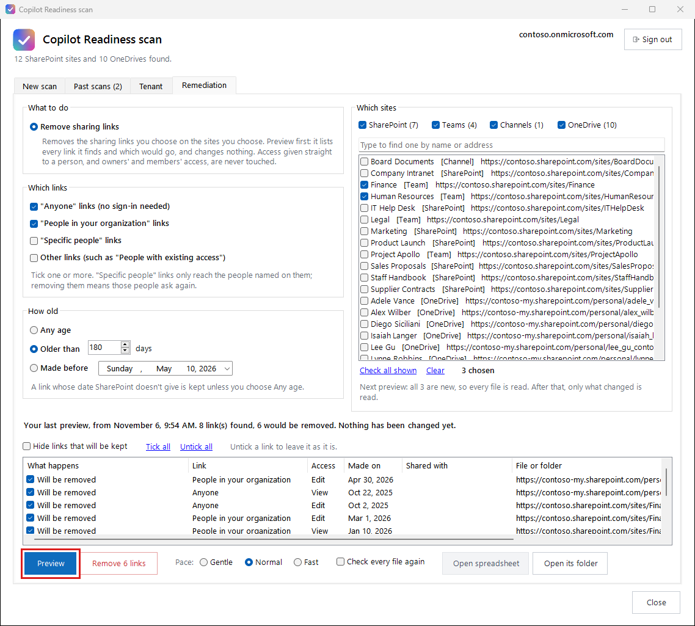

# Fixing sharing links

The **Remediation** tab removes sharing links you choose: say every "Anyone" link older than six months, or every link on your Finance and HR sites. It always shows you what it would remove first, and changes nothing until you press **Remove** and say yes.

This is the only part of Copilot Readiness that changes anything in your Microsoft 365. Scans only read.

## Choose what to remove

**Which links**: tick one or more.

| Link | Who it reaches |
|---|---|
| **"Anyone" links** | Anyone who has the link, with no sign-in |
| **"People in your organization" links** | Everyone in your company who has the link |
| **"Specific people" links** | Only the people named on the link |
| **Other links** | Such as "People with existing access", which don't give anyone new access |

"Anyone" and "People in your organization" are ticked to start with. Someone who loses a "Specific people" link has to ask for the file again, so leave that unticked unless you mean it.

**How old**: any age, older than a number of days (180 to start with), or made before a date. SharePoint records when each link was made. A link whose date SharePoint doesn't give is only removed when you choose **Any age**.

**Which sites**: tick the sites and OneDrives to clean up. The boxes above the list show or hide **SharePoint** sites, **Teams**, **Channels** (private and shared channels, which have sites of their own) and **OneDrive**. Search finds a site by name or address.

Access given straight to a person, and the access owners and members have, is never touched. Only sharing links are.

## Preview

Press **Preview**. It goes through the chosen sites in the background and lists every sharing link it finds: what kind it is, when it was made, who it's for, and whether it would be removed. Nothing is changed. You can close the window; the preview carries on, and the tab shows it again when you come back.

In the list:

- **Untick** any link you want to keep. **Tick all** and **Untick all** do every link at once.
- **Hide links that will be kept** leaves just the ones that would go.
- Click a column heading to sort by it; click again to turn the order round.
- **Open spreadsheet** has every link, in Excel.

**Pace** works as it does for a scan (Gentle, Normal or Fast), and you can change it while a preview runs.

**The next preview of a site is quicker.** The first preview of a site reads every file. After that, Copilot Readiness asks Microsoft what has changed since, including sharing changes anyone has made, and checks only those files. The site list shows when each site was last checked, and the line under it says what the next preview will do. When a folder's sharing has changed, Microsoft asks for the whole library to be read again, and it is. Tick **Check every file again** to read everything anyway.

## Remove

Press **Remove**. It says how many links will go, from how many sites, and asks you to confirm. It then removes exactly the links you left ticked in the preview, and nothing else. Each file is checked again first, so a link someone already removed is counted as already gone.

When it's done, the list shows what happened to each link (removed, already gone, not removed because you unticked it, or failed), and **Open spreadsheet** has the same. If it stops part way, the record still shows every link it removed and every link it didn't get to.

**Removing a link can't be undone.** Anyone using it loses access straight away. People who still need the file ask for a new link.

**Next:** [If something goes wrong](if-something-goes-wrong.md)
