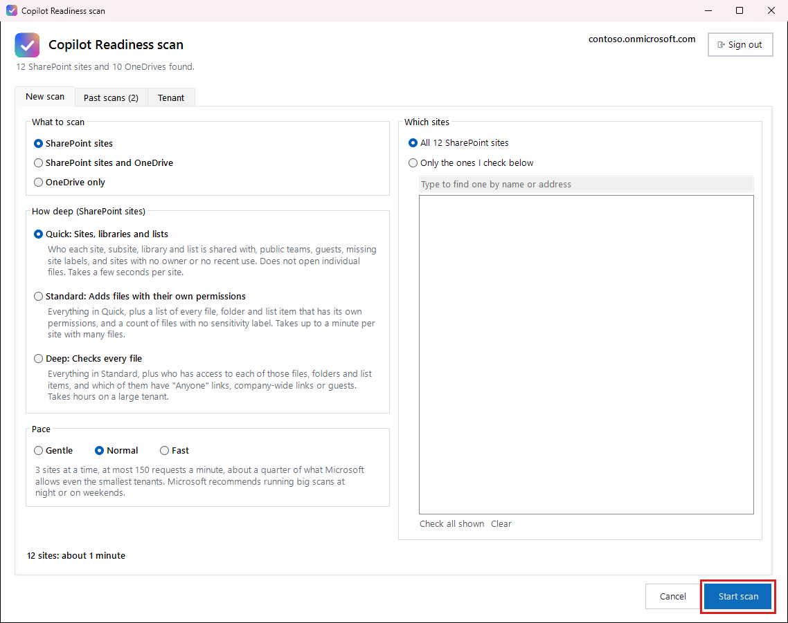
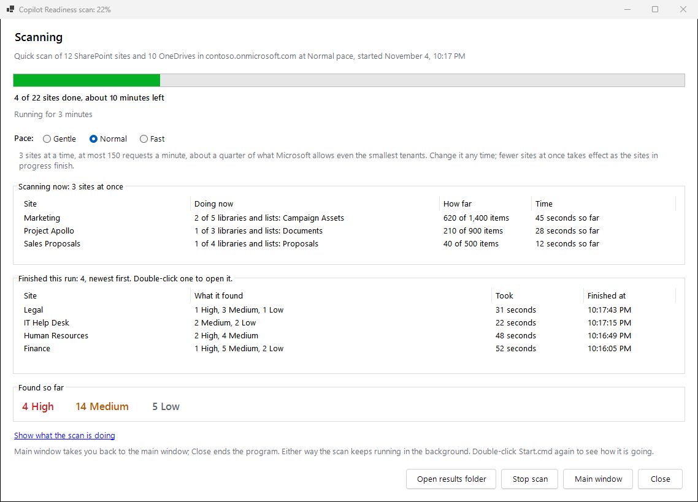
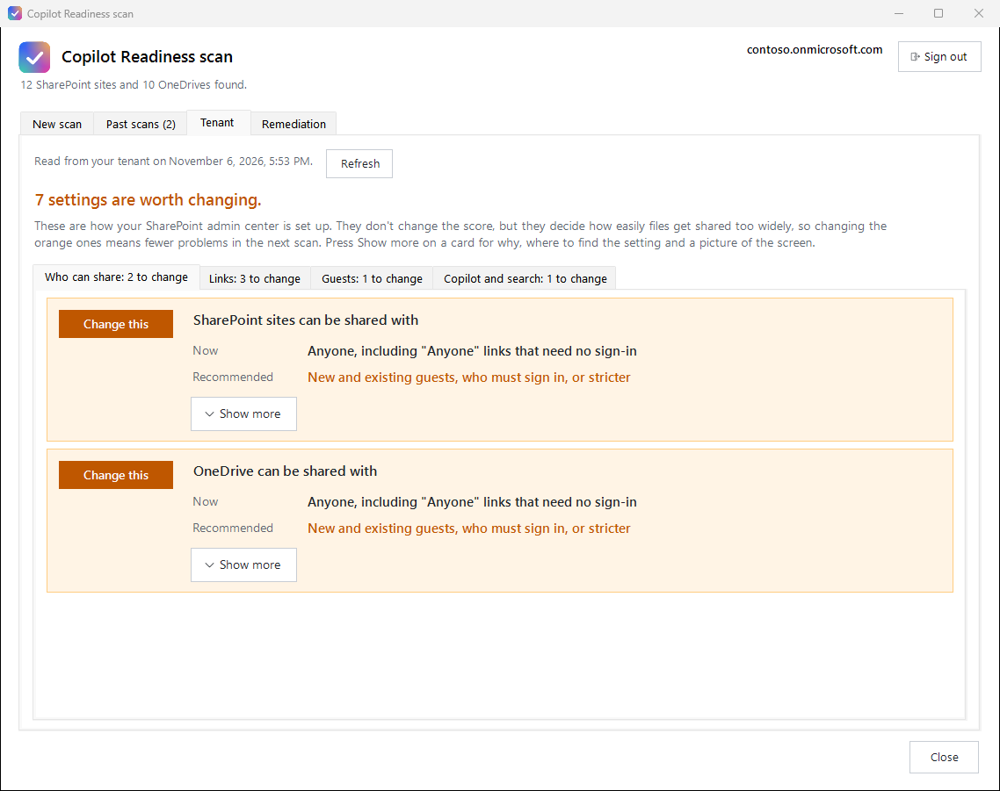

# Running the scripts

Double-click **Start.cmd**. Each time, it first checks your PC, and you only see that check if something needs fixing. Then the main window opens.

## Start a scan

For your first scan, keep the choices shown here and press **Start scan**:

- **What to scan:** SharePoint sites
- **How deep:** Quick
- **Which sites:** All
- **Pace:** Normal

The line at the bottom says roughly how long it will take.



## Your choices

**What to scan**: SharePoint sites, SharePoint sites and OneDrive, or OneDrive only. SharePoint covers team sites (with or without a Team) and communication sites, their subsites, and their libraries and lists.

**How deep**:

| Level | What it checks | How long |
|---|---|---|
| **Quick** | Who each site, subsite, library and list is shared with, public teams, guests, missing site labels, and sites with no owner or no recent use | A few seconds per site |
| **Standard** | Quick, plus a list of every file, folder and list item with its own permissions, and a count of files with no sensitivity label | Up to a minute per site with many files |
| **Deep** | Standard, plus who has access to each of those files, folders and list items, and which of them have "Anyone" links, company-wide links or guests | Hours on a large tenant |

Start with Quick across every site, then run Deep on the sites that worry you.

**OneDrive** is checked differently, whatever the level: each person's shared files are checked one by one for "Everyone" access, "Anyone" links, company-wide links and guests. Owners, labels and activity aren't judged there. The report lists the names of those shared files, so check your organization is happy with that before scanning OneDrive.

**Pace** sets how hard the scan works your tenant:

| Pace | How it scans | When to use it |
|---|---|---|
| **Gentle** | 2 sites at a time, at most 60 requests a minute (about a tenth of the smallest allowance) | A busy tenant during the working day |
| **Normal** | 3 sites at a time, at most 150 requests a minute (about a quarter) | Most scans |
| **Fast** | 4 sites at a time, at most 300 requests a minute (about half) | Nights and weekends |

Microsoft gives each app an allowance of requests in each tenant; the smallest tenants (under 1,000 licenses) get about 600 a minute. Whatever the pace, when Microsoft says wait, every site being scanned waits as long as Microsoft asks. The same numbers are used for every tenant, so no tenant is pushed near its limits and its other apps keep most of their share. Even Fast running for a whole day stays under Microsoft's daily limit.

Microsoft recommends running big scans at night or on weekends, when it slows apps down least. Run a Deep scan of a large tenant overnight if you can. Microsoft's guidance: [Avoid getting throttled or blocked in SharePoint Online](https://learn.microsoft.com/en-us/sharepoint/dev/general-development/how-to-avoid-getting-throttled-or-blocked-in-sharepoint-online).

## Watch it run

A progress window shows how far along it is and what it has found so far. You can keep using your PC. You can even close this window, and the scan keeps going in the background; double-click **Start.cmd** to see it again.



For each site it's on now, the window shows what it is doing, how many items it has checked, and how long that site has left. **Show what the scan is doing** lists each site as it finishes. **Main window** takes you back to the main window, where the scan shows under Past scans as running now, and **Show progress** there brings this window back.

**You can change the pace while a scan runs.** A new number of requests a minute takes effect within a couple of seconds. Fewer sites at a time takes effect as the sites in progress finish, and more sites start right away. The scan keeps the new pace if you stop it and continue later.

## Stop and continue

Every site is saved as soon as it's done. If a scan stops (you press **Stop scan**, the PC restarts, or the connection drops), double-click **Start.cmd** and choose **Continue that scan**, or press **Continue** in the progress window. It picks up at the next site. A site that was partway through picks up where it left off, so a stop costs at most a minute or so of work. Nothing from a half-finished site appears in the report until the whole site is done. The one scan you can't continue is one started under different rules from this version's: start a new scan instead, or if it started in a newer version, continue it there.

## Check your tenant's sharing settings

The **Tenant** tab shows how your tenant is set up for sharing and Copilot, read from the SharePoint admin center. Each setting is a card marked **Change this**, **Good** or **Just so you know**, showing what it is **Now** and what we **Recommend**, in plain words. The cards are grouped on tabs (**Who can share**, **Links**, **Guests**, **Copilot and search**), and each tab says how many of its settings are worth changing.



**Show more** on a card opens the rest: why it matters, the trail to follow to reach the setting, a picture of that screen where there is one, and buttons to Microsoft's guide and to the page where it is changed. A setting that's changed with PowerShell and needs changing has a **PowerShell** button, which opens the commands to change it, with the first line already set to your tenant. Choose **PnP** (PnP PowerShell, in PowerShell 7) or **SPO** (the SharePoint Online module, in Windows PowerShell); every card follows your choice. **Copy** copies the commands, which include how to see the current value. The undo line is only a note until you take the `#` off the front, so pasting the whole block makes the change and leaves it made. Keep that line before you press **Refresh**: once a setting is right, its card stops offering commands. PnP needs a client ID from an app of your own: **Set up a PnP client ID** opens the steps to make one. These settings don't change the score; they decide how easily files get shared too widely, so fixing them means fewer findings next time. If the settings can't be read, the tab says why and the scan still runs.

The settings are read from your tenant the first time and kept, so the window opens quickly after that. The top of the tab says when they were read. Press **Refresh** to read them again, say after changing a setting in the admin center; the window closes and opens again on this tab.

## Run it without the window

For a scheduled task, or any time you'd rather type. From PowerShell 7 in this folder, the scan runs in the PowerShell window itself and shows its progress there; Ctrl+C stops it. If Windows blocks the script, unblock the folder once with `Get-ChildItem -Recurse | Unblock-File`. Start.cmd doesn't need this.

```powershell
./Start.ps1 -Level Quick -NoWindow
./Start.ps1 -Level Deep -Pace Fast -NoWindow          # overnight
./Start.ps1 -Level Deep -Sites https://contoso.sharepoint.com/sites/finance, https://contoso.sharepoint.com/sites/hr
./Start.ps1 -Level Standard -SitesFile sites.txt    # one site address per line
./Start.ps1 -Level Quick -Include Both -NoWindow     # SharePoint and OneDrive
./Start.ps1 -Include OneDrive -NoWindow             # OneDrive only
./Start.ps1 -Resume                                  # continue the last unfinished scan
```

**Next:** [The reports](the-reports.md)
