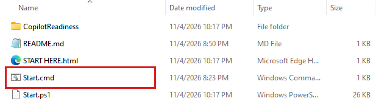
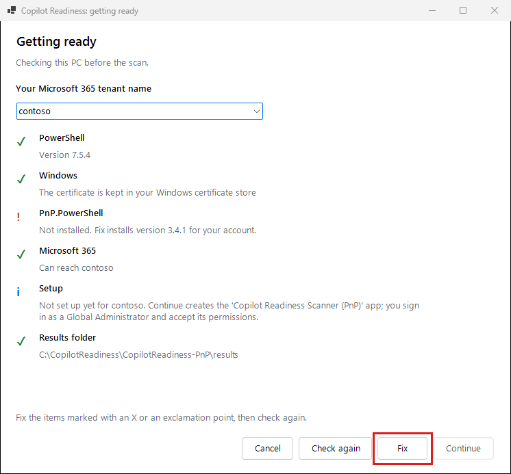
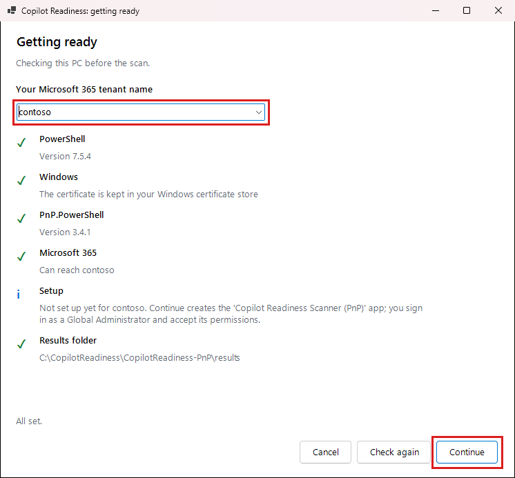
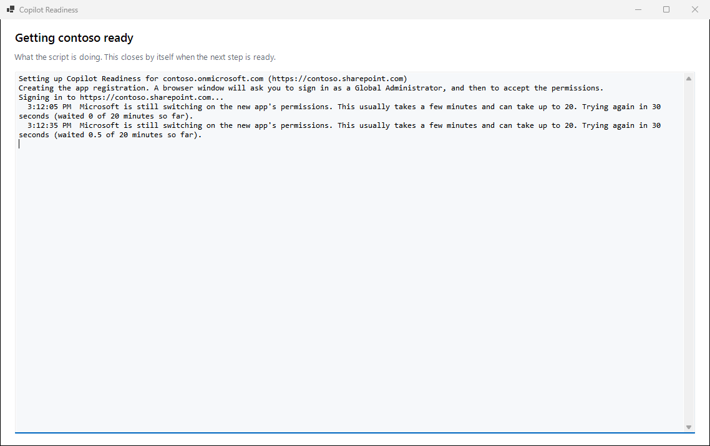

# Setting it up

Connect Copilot Readiness to your Microsoft 365. You only do this once on each PC.

Allow about 30 minutes, most of it waiting for Microsoft. You need someone who can sign in as a **Global Administrator** of your Microsoft 365. After this, anyone with this folder on this PC can run a scan.

## Double-click Start.cmd

Open the folder you extracted, then the **CopilotReadiness-PnP** folder inside it, and double-click **Start.cmd**. Your PC may show it as just **Start**, with a gear icon.

A black window opens first. Leave it open; you can minimize it. It goes away when you're finished. If it says it needs PowerShell, go back to [Install PowerShell 7](install.md#install-powershell-7), or restart your PC if you've already done it.

If Windows shows a blue **Windows protected your PC** box, press **More info**, then **Run anyway**. Only do this if the zip came from someone you trust.

## Press Fix if you see it

A **Getting ready** window checks your PC. A green check mark means that item is fine. If **Fix** appears, press it. It installs PnP.PowerShell, the one other thing the scan needs, which takes a minute or two.

## Type your tenant name and press Continue

Your tenant name is the first part of your SharePoint address. If your sites are at `contoso.sharepoint.com`, type `contoso`. Then press **Continue**.

## Sign in and accept

Your web browser opens and shows Microsoft's own pages:

1. Sign in as a **Global Administrator**.
2. Microsoft lists the permissions the scan's app needs. Press **Accept**.

The page opens in your default browser, in whichever profile it last used, so check any other browser windows if you don't see it. If it shows the wrong account, choose **Use another account**. If you use a separate browser profile for this tenant, make that the last one you used before you start.

This creates an app called **Copilot Readiness Scanner (PnP)** in your tenant, with a certificate kept in your Windows certificate store. The app can read every site and who it is shared with. A scan never changes anything; the only thing that does is the Remediation tab's **Remove** button, which removes sharing links you chose after showing you a preview ([Fixing sharing links](fixing-sharing-links.md)). The permissions are listed at the top of `Start.ps1`, and the details are saved in `settings.json`.

## Wait while Microsoft switches it on

Go back to the Copilot Readiness window. Microsoft usually takes a few minutes to switch the permissions on, and sometimes up to 20. A blue box says nothing is wrong and counts down to the next try. It keeps trying by itself, so there's nothing to press.

When it's ready, the main window opens by itself.

## Another tenant

The top right of the main window shows which tenant you're signed in to. **Sign out** asks which tenant to scan next. The first time, that tenant is set up like the first one, with its own app, and you sign in as one of its Global Administrators. Every tenant set up on this PC is remembered, so switching back needs no new setup, and you can pick it from the list. Each scan, and the offer to continue one, belongs to its own tenant.

From PowerShell, `./Start.ps1 -Tenant fabrikam` switches straight to that tenant.

## A newer version

You only set up once on each computer. A newer version uses the same app and certificate. [Getting a newer version](install.md#getting-a-newer-version) has the steps.

## Another PC

Your tenant only needs one app, and each computer gets its own certificate for it. When you set up a second computer, the window tells you the app is already registered but this computer has no certificate yet, so it creates one and adds it. To scan from a second computer:

1. [Install](install.md) on that PC, then double-click **Start.cmd** and type the same tenant name.
2. Sign in as a **Global Administrator**. You'll be asked twice: once to check the tenant, and once to add this PC.
3. Wait for the blue box to finish. This took a minute or two in our tests, and can take longer. Microsoft can take about six minutes to always accept a new certificate, so a scan started straight away may pause by itself for a while. That is normal.

There's normally no **Accept** page this time, because the app's permissions were already accepted. If the first setup stopped before they were, the window asks you to press **Accept**. Your other PCs keep working.

Each PC keeps its own settings and scan results. If two PCs scan the same tenant at the same time, they share one allowance from Microsoft, so use **Normal** or **Gentle** pace.

**Next:** [Running the scripts](running-the-scripts.md)
