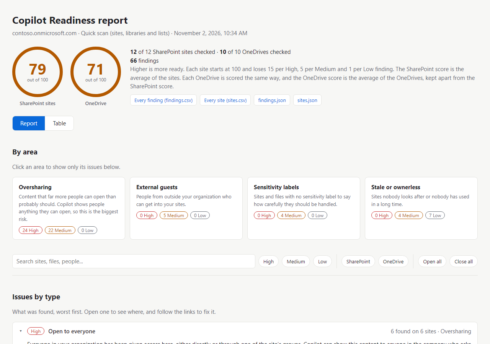
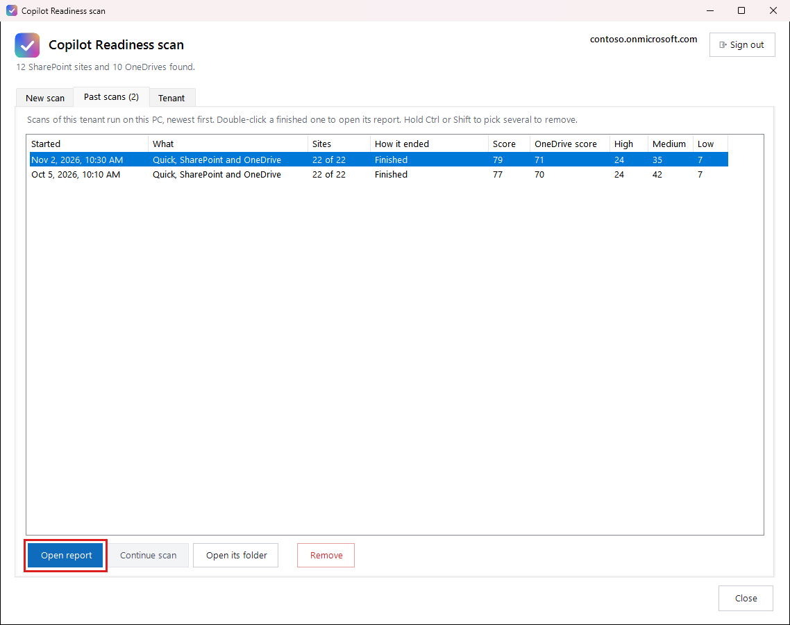

# The reports

When a scan finishes, the report opens in your web browser. Without the window, the scan prints where the report is.

## Read the scores

The numbers at the top are your scores out of 100, and higher is more ready. Each site starts at 100 and loses 15 points per High, 5 per Medium and 1 per Low finding. The SharePoint score is the average of the SharePoint sites. Each OneDrive is scored the same way, and the OneDrive score, shown beside it, is the average of the OneDrives and is kept apart from the SharePoint score.

## Find what to fix

Every issue is listed two ways, by kind of issue and by site, with OneDrive in a part of its own. Each opens with a click and links straight to the site, library, folder or file. Search, the High, Medium and Low buttons and the SharePoint and OneDrive buttons narrow it down; clicking an area shows only its issues.

The **Table** view shows the same rows as the spreadsheets below, as tables: click a column heading to sort, type or pick under a heading to filter, show or hide columns, and **Download these rows** to save just what you see.

## Open an old report

Open the **Past scans** tab, pick a scan and press **Open report**, or double-click it. It lists every scan of the tenant run on this PC, newest first, with its score and what it found. Pick one that stopped and press **Continue scan** to finish it. **Remove** sends the scans you pick to the Recycle Bin.

## The files it saves

Each scan gets its own folder under `results`:

- `report.html`: the report. It links to the files below, so keep them together.
- `findings.csv`: every finding with what to do about it. Opens in Excel.
- `onedrives` folder: one spreadsheet per OneDrive that has findings, named after its owner, so each person can be given just their own. Same columns as `findings.csv`, and the report links to each one.
- `sites.csv`: every site with its score.
- `unique-permissions.csv` (Standard and Deep): every file, folder and list item on a SharePoint site that has its own permissions, with a link to it and, after a Deep scan, who has access. The report lists them by site too, so you can decide whether each should keep its own permissions. They don't change the score; each library with any already loses a point.
- `scan.json`, `sites.json`, `findings.json`: the same results for other tools.

To share a report, send the whole folder and open it from your computer. Some viewers, such as OneDrive's, may not open the links to these files.

## Sites left out

Some sites are listed apart under **Sites left out**, each with the reason, and aren't scored. Sites an admin has archived (Microsoft 365 Archive) or locked are left out because nobody can open them, Copilot included, so they aren't retried either. The tenant's app catalog is left out on purpose: everyone needs to be able to read it to add apps, and it holds app packages rather than business documents. Sites that couldn't be read for any other reason are listed with the reason, and the next scan tries them again.

**Stuck?** See [If something goes wrong](if-something-goes-wrong.md).
